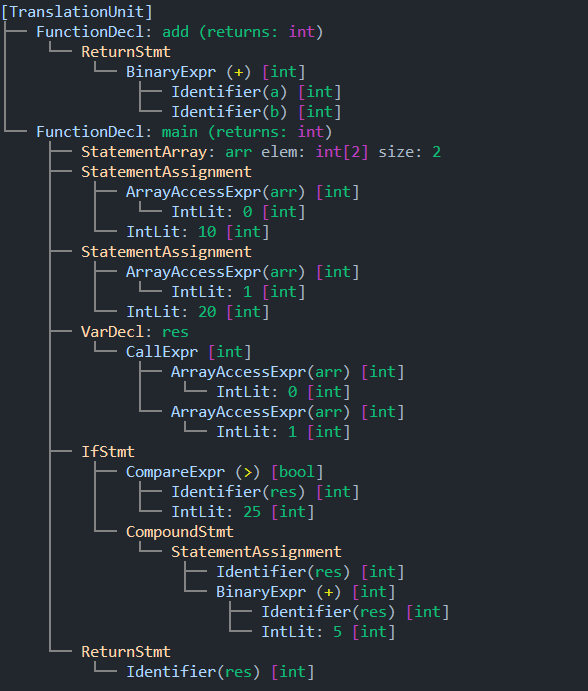

<div align="center"> <h1 style="font-size: 2.5em; font-weight: bold; margin-bottom: 8px;">
     CForge
  </h1>

[](https://github.com/NightProgrammer1/C-compiler/actions/workflows/test.yml)

</div>

> **CForge** is an experimental Linux C compiler inspired by GCC. Its multi-stage pipeline includes:
>
> - **Front-End:** Tokenization (**Lexer**), Abstract Syntax Tree (**AST**) generation, and Semantic Analysis for type checking and decoration.
> - **Middle-End & Optimizations:** Constant folding and dead-code reduction, followed by Intermediate Representation (**IR**) lowering, Control Flow Graph (**CFG**) analysis, and linear-scan register allocation.
> - **Back-End:** Native x86-64 assembly generation, automated NASM compilation, and GNU linking (`ld`).

---

<br>

### Supported Language Subset

* **Data Types & Memory Model**

* **Primitives:** Core signed integers (`int`)

* **Pointers:** Full pointer arithmetic, pointer subtraction, and dereferencing

* **Arrays:** Single and multi-dimensional arrays, array parameters, and pointers to arrays

* **Control Flow & Functions**

* **Branching:** Conditional execution with `if` and `else` blocks

* **Iteration:** Stateful loops via `while` and `for` constructs

* **Control Flow Modifiers:** Native `break` and `continue` statements

* **Subroutines:** Function definitions, argument passing, and automated inlining

* **Compiler Optimizations**

* **Constant Folding:** Compile-time evaluation of constant expressions to reduce runtime overhead

---

### Source Code Example


### AST Representation



---

### Usage & CLI Flags

Compile source files directly from the command line using the `cf` binary:

```bash
# Compile a source file into an executable (.out)
cf input.c
# Compile and specify a custom output filename
cf input.c -o custom_output
# Print the generated Abstract Syntax Tree (AST) and exit early
cf input.c --print-ast
# Print the generated x86-64 assembly during compilation
cf input.c --print-assembly
# Print the debug information (compile speed, ect)
cf input.c -g || cf input.c --debug
# Disable all Optimizations
cf input.c -O0

```
